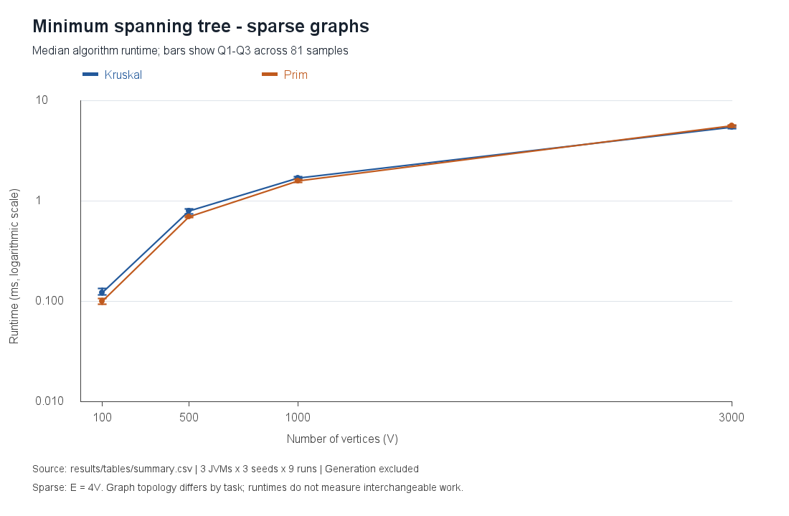
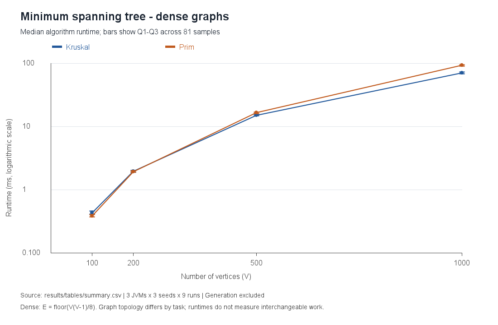
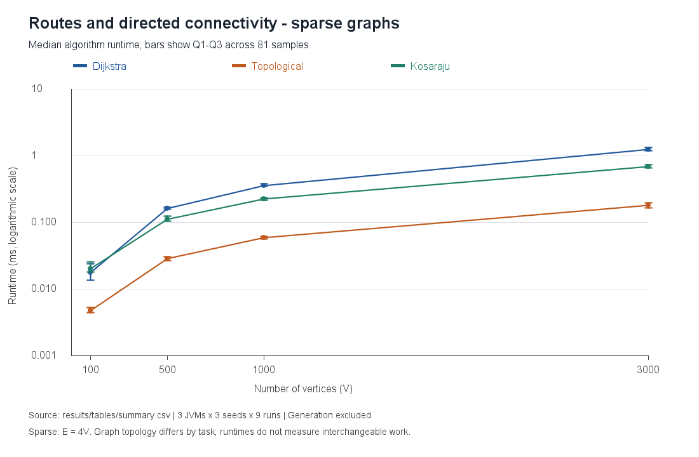
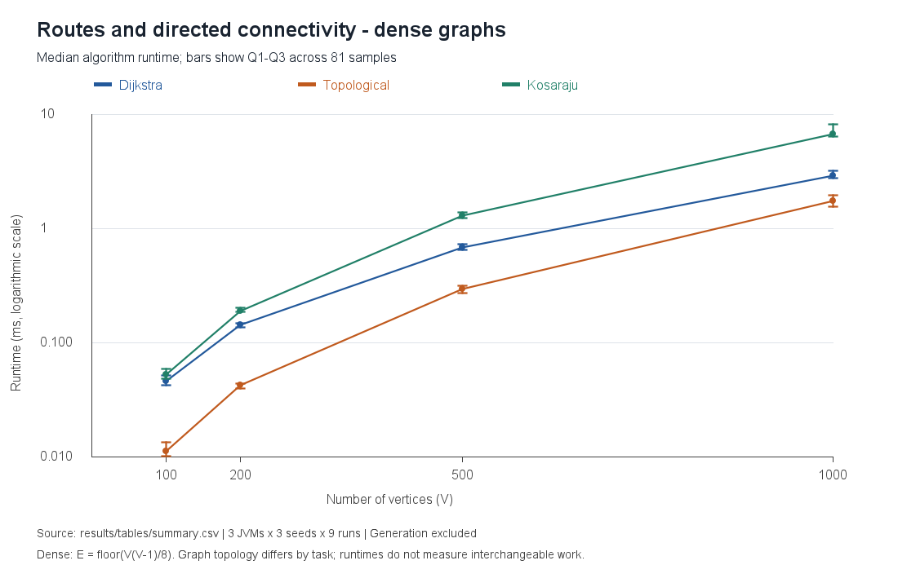
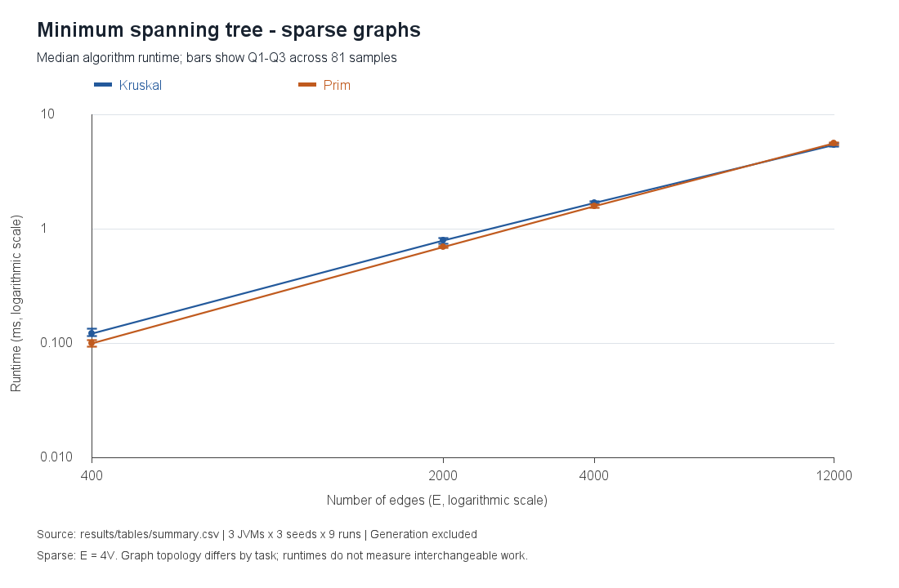
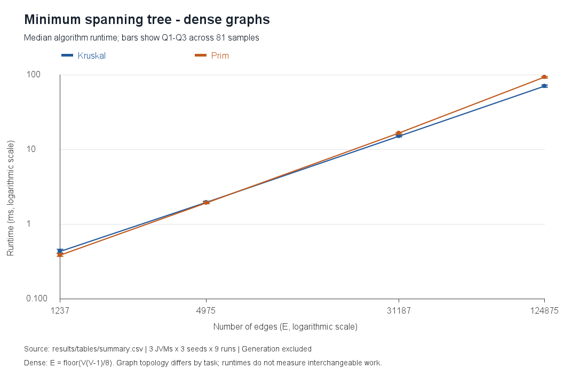
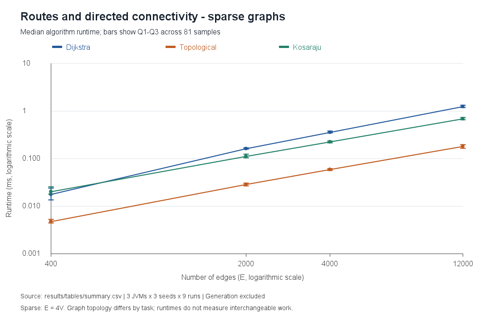
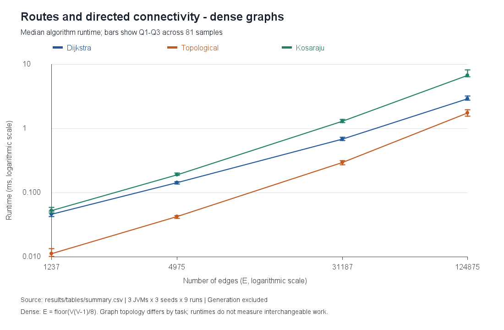

# Assignment 3 — Smart City Infrastructure and Route Planning

Design and Analysis of Algorithms · Java 17 · No external dependencies

## Overview

This application models city districts as graph vertices and roads or infrastructure connections as weighted edges. It supports three planning questions:

1. **Infrastructure:** What is the minimum total construction cost needed to connect every district? Kruskal and Prim compute a minimum spanning tree (MST), or a minimum spanning forest when the input is disconnected.
2. **Connectivity:** Which locations can all reach each other through one-way roads? Kosaraju finds strongly connected components (SCCs). Kahn's topological ordering schedules infrastructure services whose dependencies form a directed acyclic graph (DAG).
3. **Routing:** What is the shortest distance from one location to the others? Dijkstra computes distances and reconstructs actual routes.

Construction cost and travel distance are different meanings of an edge weight. The demo uses the same numbers to illustrate both tasks; a real city should supply separate cost and distance graphs. An MST minimizes the **sum of construction costs**, not every pairwise travel distance.

The project implements all six required algorithms and compares Dijkstra's execution time and logical operation counts across graph sizes. Since the supplied instructions do not prescribe exact sizes or measurement settings, the choices are documented below.

The [correctness and results audit](results/audit.txt) records the checks performed on the implementation and saved measurements. A [Russian defense preparation guide](docs/assignment-3-defense-guide-ru.docx) explains the algorithms, examples, results and likely oral questions.

### Project structure

```text
assignment-3/                 # Repository root; the local folder may have another name
├── src/
│   ├── app/                  # CLI and city demonstration
│   ├── graph/                # Adjacency-list graph, edge record, file parser
│   ├── dsu/                  # Path compression and union by size
│   ├── mst/                  # Kruskal, priority-queue Prim, forest result
│   ├── connectivity/         # Kahn topological ordering, iterative Kosaraju
│   ├── shortestpath/         # Dijkstra and route reconstruction
│   └── benchmark/            # Generators, JVM workers, independent validation, plots
├── tests/                    # Dependency-free tests with independent oracles
├── examples/                 # City roads, one-way roads, service dependencies
├── results/
│   ├── tables/               # Raw samples, answers, per-JVM CSV, summary table
│   ├── plots/                # Eight PNG figures: time versus V and versus E
│   ├── logs/                 # Per-JVM progress, environment and actual warmup counts
│   ├── environment.txt       # JVM, OS, processor and measurement settings
│   ├── sources.sha256        # Source fingerprints for the measured implementation
│   └── integrity.sha256      # Fingerprints of saved data, logs and figures
├── .github/workflows/        # Compile, test and demo on Java 17
├── run.ps1
└── README.md                 # Complete report
```

### Compile and run

Install a **JDK 17 or later**, with `java` and `javac` on `PATH`. No Maven, Gradle, Python, chart library, or downloaded Java dependency is needed. Run commands from the repository root.

Windows PowerShell:

```powershell
powershell -NoProfile -ExecutionPolicy Bypass -File .\run.ps1 demo
powershell -NoProfile -ExecutionPolicy Bypass -File .\run.ps1 test
powershell -NoProfile -ExecutionPolicy Bypass -File .\run.ps1 file examples\one-way.txt 0
powershell -NoProfile -ExecutionPolicy Bypass -File .\run.ps1 benchmark
powershell -NoProfile -ExecutionPolicy Bypass -File .\run.ps1 verify
```

The execution-policy option applies to that PowerShell process; it does not change the machine's configured policy. If local scripts are already permitted, `./run.ps1 test` also works.

Every invocation of `run.ps1` compiles `src/` and `tests/` into ignored `build/`. The `compile` task only compiles. The `plots` task checks the data and redraws the figures without rerunning measurements. The `verify` task regenerates inputs and independently checks saved answers, summary statistics and file fingerprints. Equivalent Java entry points after compilation are:

```sh
java -cp build app.Main demo
java -cp build app.Main file examples/city.txt 0
java -cp build tests.AlgorithmTests
java -Xms256m -Xmx1g -cp build benchmark.Benchmark
java -cp build benchmark.PlotResults
java -cp build benchmark.VerifyResults
java -cp build tests.ResultAuditTests
```

### Custom graph input

The first nonempty, uncommented line is `directed V` or `undirected V`. Each remaining line is `from to weight`. Vertex IDs must be between `0` and `V-1`; weights must fit a signed Java `int`. Whitespace, blank lines and `#` comments are supported. Edges are counted from the file.

```text
undirected 4
0 1 4
1 2 2
0 2 8
# Vertex 3 is isolated.
```

This example has a minimum spanning forest of weight 6 and two components. Vertex 3 is unreachable from source 0. The CLI uses source 0 unless a source argument is supplied. Invalid input produces a message on standard error and a nonzero exit code.

## Implementation

### Graph representation and contracts

[`Graph`](src/graph/Graph.java) uses adjacency lists plus a list of original edges. A directed edge appears once in adjacency; an undirected edge has two adjacency arcs but appears once in the original edge list. Both representations require **O(V + E)** space. Keeping the original list simplifies Kruskal and avoids counting each undirected road twice. Accessors expose unmodifiable views; algorithms do not modify the input graph. Callers should not mutate a graph while an algorithm is running.

Self-loops, parallel edges, isolated vertices, zero weights and disconnected inputs are supported. MST algorithms accept negative weights, ignore cycle-forming edges, and require an undirected graph. Connectivity algorithms require a directed graph. Distances and total MST weights use `long`, avoiding overflow when many `int` weights are added. With int-sized vertex IDs and int edge weights, a simple path or forest total fits in a `long`.

An empty undirected graph has zero components, weight zero, and is considered trivially connected by the API. A singleton is connected. An empty directed graph has an empty topological order and no SCCs. Dijkstra requires an existing source vertex, so it rejects an empty graph. An unreachable distance is `Long.MAX_VALUE`, and its route is an empty list. These conventions are explicit rather than silently omitting vertices.

### DSU and Kruskal

[`DisjointSetUnion`](src/dsu/DisjointSetUnion.java) starts with one set per vertex. `find` walks to the representative and then compresses the entire visited path. `union` attaches the smaller set below the larger set, returns whether a merge occurred, and updates a component count.

[`Kruskal`](src/mst/Kruskal.java) sorts a copy of the original edge list by weight, with endpoint tie breakers. It accepts an edge only when DSU reports that its endpoints belong to different components. The returned edge list, weight and component count describe a minimum spanning forest. Connected inputs stop accepting/scanning edges once one component remains, although all edges have already been sorted.

**Correctness:** each accepted edge is a minimum-weight available connection across a cut between current components. The cut property makes it safe to add to some MST. DSU prevents cycles. Applying the same argument within each connected component gives a minimum spanning forest when no global spanning tree exists.

### Priority-queue Prim

[`Prim`](src/mst/Prim.java) grows a tree from an unvisited vertex. A Java `PriorityQueue` stores frontier **edges**, and the smallest edge to an unvisited vertex is selected. An edge whose destination is already visited is stale and is discarded when removed. Restarting at every remaining unvisited vertex handles disconnected graphs and isolated districts.

This is **lazy Prim**, not an indexed decrease-key heap. Its queue can hold O(E) edges, which matters in both complexity analysis and the dense-graph measurements. Sorting/queue ties may select different equal-cost trees, so comparison checks total weight and component count rather than identical edge lists.

**Correctness:** the queue contains every candidate edge crossing from the current tree to an unvisited vertex. Removing stale entries leaves a minimum-weight crossing edge, which is safe by the cut property. The argument repeats independently in each connected component.

### Topological ordering

[`TopologicalSort`](src/connectivity/TopologicalSort.java) implements Kahn's algorithm: calculate indegrees, enqueue zero-indegree vertices, output them, and decrement the indegrees of their outgoing neighbors. If fewer than V vertices are processed, a directed cycle exists. The API returns an `acyclic` flag; any partial order on failure is **not** a valid topological ordering of the full graph. The CLI reports the cycle instead of displaying that prefix as a solution.

**Correctness:** a zero-indegree remaining vertex has no unmet incoming dependency. Removing such vertices preserves this invariant. A nonempty remaining subgraph with no zero-indegree vertex contains a cycle, so a full ordering exists exactly when every vertex is removed.

### Strongly connected components

[`Kosaraju`](src/connectivity/Kosaraju.java) first performs DFS on the original graph, recording vertices when they finish. It constructs the transpose and explores it in decreasing original finishing order. Each second-pass DFS produces one SCC. Both DFS passes use explicit stacks, avoiding recursion depth failures on long road chains. The first pass stores each vertex's next adjacency index to preserve true DFS finishing order.

**Correctness:** collapsing SCCs forms a DAG. Decreasing finish times select components in the order that prevents transpose DFS from escaping into another unprocessed component. Each traversal therefore visits precisely one maximal set of mutually reachable vertices. Isolated vertices each form an SCC.

### Dijkstra

[`Dijkstra`](src/shortestpath/Dijkstra.java) maintains tentative distances and predecessor vertices. The priority queue contains `(vertex, distance)` entries. Each successful relaxation adds a new entry; old entries are skipped if their recorded distance no longer matches the current best distance. The entire edge list is checked for negative weights before computation, including edges unreachable from the source. Negative-weight inputs are rejected because Dijkstra's guarantee does not apply to them.

The result exposes `distanceTo` and `pathTo`. The latter follows predecessors and reverses the route; a source-to-source route contains just the source. Strictly improving relaxation avoids predecessor cycles even with zero-weight edges.

`computeWithOperations` uses the same algorithm loop with optional counters. It records weight checks, scanned adjacency arcs (relaxation attempts), successful relaxations, queue pushes/pops, stale pops, settled vertices and peak queue size. These are explicitly defined logical events, not CPU instructions or internal heap comparisons. Ordinary `compute` disables counting; the benchmark measures that mode and collects counts in separate untimed calls.

**Correctness:** when the smallest current tentative distance is removed, no later path through vertices with greater or equal distances can improve it using nonnegative edges. Relaxation preserves best-known path lengths. Thus all reachable final distances are shortest, and predecessors reconstruct paths with those lengths.

## Complexity Analysis

Let V be the number of vertices, E the number of original edges and alpha(V) the inverse Ackermann function. Undirected adjacency stores 2E arcs, a constant-factor difference. Auxiliary space below excludes the input graph but includes queues, temporary graphs and returned results. Logarithms can be read as `log(E + 1)` to cover graphs without edges.

| Algorithm | Time | Auxiliary space | Reason |
| --- | --- | --- | --- |
| DSU initialization | O(V) | O(V) | Parent and size arrays |
| DSU `find` / `union` | O(alpha(V)) amortized per operation | O(1) per call beyond DSU arrays | Path compression plus union by size; this is not a worst-case bound for each individual call |
| Kruskal | O(V + E log(E + 1)) | O(V + E) | Edge copy/sort dominates DSU operations; output has at most V-1 edges |
| Lazy Prim | O(V + E log(E + 1)) | O(V + E) | Scan adjacency, enqueue/remove up to O(E) frontier edges, visit every component |
| Kahn topological ordering | O(V + E) | O(V) | Each vertex and edge is processed a constant number of times |
| Iterative Kosaraju | O(V + E) | O(V + E) | Two traversals plus a transpose; traversal state alone is O(V) |
| Lazy-queue Dijkstra | O(V + E log(E + 1)) | O(V + E) | O(E) successful relaxations/queue entries plus weight validation and array initialization |
| Dijkstra route reconstruction | O(L) | O(L) | Follow and reverse a path of L vertices, L <= V |

On simple graphs, E is O(V²), so log E is O(log V). For connected graphs these heap-based bounds are commonly written O(E log V), or O((V + E) log V) for Dijkstra. The more explicit bounds above describe these implementations even when parallel edges or many isolated vertices are present. A binary **indexed** heap could reduce Prim/Dijkstra queue storage to O(V); this project uses Java's standard priority queue with lazy entries.

For the sparse family, E = 4V, so the expected bounds are O(V log V) for MST/routing and O(V) for SCC/topological ordering. For the dense family, E is Theta(V²), giving O(V² log V) for the implemented MST/routing algorithms and O(V²) for SCC/topological ordering. An adjacency-matrix Prim implementation can achieve O(V²) time on dense graphs, but it is not the priority-queue implementation benchmarked here.

## Experimental Setup

### Reproducible graph families

[`GraphGenerator`](src/benchmark/GraphGenerator.java) uses Java `Random` with seeds **42, 2025 and 8675309**. Each configuration has three independently seeded instances. Edges have integer weights uniformly drawn from **1 through 1000**. Benchmark graphs are simple: no self-loops or duplicate endpoint pairs.

| Family | Vertex counts | Edge-count rule | Exact edge counts |
| --- | --- | --- | --- |
| Sparse | 100, 500, 1000, 3000 | E = 4V | 400, 2000, 4000, 12000 |
| Dense | 100, 200, 500, 1000 | E = floor(V(V-1)/8) | 1237, 4975, 31187, 124875 |

For undirected graphs, the dense rule uses approximately 25% of all possible edges. For general directed graphs, it uses approximately 12.5% of possible arcs. “Dense” means E grows quadratically, not that the graph is complete. All tasks use the same V and E within a configuration, but directed and undirected edge densities are not interchangeable.

- **MST and Dijkstra:** start with a random spanning tree by connecting each vertex to a random earlier vertex. Add random unused undirected edges until reaching E. All three algorithms receive exactly the same graph for each seed/configuration. Dijkstra starts at vertex 0.
- **Topological ordering:** start with the chain `0 -> 1 -> ... -> V-1`, then add unused arcs from lower to higher IDs. This guarantees a DAG with the requested E. Because the chain constrains every vertex, this family has a unique order and does not exercise broad ready queues; random DAG correctness tests cover more varied orders.
- **SCC:** partition vertices into blocks of 20 and insert a directed ring in every block. Add random unused arcs inside blocks or from an earlier block to a later block. Each ring guarantees internal strong connectivity, and the forward-only cross-block rule prevents merging blocks. The expected SCC count is exactly V/20. Benchmark sizes are multiples of 20.

Graph construction is reproducible but is **not a uniform sample of all graphs** of that size. Connected road graphs are conditioned on their initial spanning tree; directed families are deliberately structured. Disconnected graphs, negative MST weights and other boundary cases are covered by tests instead of timing experiments.

### Measurement procedure

[`Benchmark`](src/benchmark/Benchmark.java) starts **three fresh JVM workers sequentially**, each with `-Xms256m -Xmx1g`. Each worker executes all 24 graph cases (8 configurations × 3 seeds):

1. Shuffle the complete case list with `new Random(91000 + fork)`, using fork IDs 1, 2 and 3. The case sequence is deterministic and differs between JVMs.
2. Regenerate and independently validate each case's road, DAG and SCC graphs before timing.
3. Warm up each algorithm on that exact graph for **at least 10 invocations AND at least 250 ms of cumulative algorithm execution time**. Actual warmup counts and durations are saved in `results/logs/warmup-N.csv`. There is no separate fixed startup warmup. Warmup reduces JIT effects but does not prove compilation has completely stabilized.
4. Measure nine individual invocations per algorithm per graph using `System.nanoTime()`. Rotate algorithm order in each measurement round.
5. Outside the timer, traverse each returned result, compute a checksum, compare it with the validated baseline, and update a volatile checksum. Recompute graph hashes after timing to detect input mutation.
6. Pool 3 JVMs × 3 seeds × 9 calls = **81 observations per algorithm/configuration**. The summary gives median, Q1, Q3, minimum and maximum. Quantiles use linear interpolation at index `(n-1)*p`. With 81 observations, Q1, median and Q3 have exact zero-based ranks 20, 40 and 60.

There are 8 configurations × 3 seeds × 3 JVMs × 5 algorithms × 9 measurements = **3,240 timed calls**. Each observation times one invocation, not a batch. Graph generation, correctness validation, checksum traversal, route printing, file I/O and plotting are excluded. Required algorithm work—including Kruskal's copy/sort, Kosaraju's transpose, Dijkstra's negative-edge check, allocations and result construction—is included. A small call/timer overhead remains. GC pauses during a call remain in the measurements. No forced garbage collection or outlier removal is performed. The independent workers run sequentially, so they do not compete with each other for CPU time.

[`Evidence`](src/benchmark/Evidence.java) validates **every benchmark case** before timing. An O(V² + E) array-based Prim implementation, without a heap or DSU, provides an MST weight oracle. Both measured trees must use input edges and connect all vertices with exactly V-1 edges. Bellman–Ford independently checks Dijkstra's distances; reconstructed routes must have matching weights and endpoints. SCCs must match the exact planted 20-vertex blocks, not just their count. A topological result must be a full permutation respecting every arc. The separate correctness suite also uses exhaustive MST enumeration and Floyd–Warshall on small inputs.

The recorded run used Microsoft OpenJDK **17.0.20.1**, Windows 11 amd64, 16 available logical processors, an Intel family 6/model 154 CPU identifier, and a 1 GiB maximum heap. Algorithms run on a single thread. Exact runtime details and the measurement timestamp are in [`results/environment.txt`](results/environment.txt).

### Dijkstra operation counts

For each of the 24 seeded road graphs, an additional untimed call records counters in [`dijkstra-operations.csv`](results/tables/dijkstra-operations.csv), together with the graph hash and result checksum. Its distances and paths must match ordinary Dijkstra. Counts are collected once per seed because they are deterministic for a fixed graph and queue implementation; repeating identical counts across JVM forks would add no information. The report shows per-column medians across the three seeds.

Weight validation visits E original edges. Every reachable vertex is settled once, and each of its adjacency arcs is scanned once. All benchmark road graphs are connected and undirected, so relaxation attempts equal 2E and settled vertices equal V. Pushes equal successful relaxations plus the initial source entry; pops equal pushes because this implementation drains the queue. Stale pops equal pops minus settled vertices. Peak queue size is a count of stored entries, not a measurement of memory bytes. Array initialization and comparisons internal to `PriorityQueue` are not counted.

### Reproducing the report

Run `test`, then `benchmark`, then `verify` using `run.ps1` as shown above. Expect the full benchmark to take several minutes: mandatory warmup alone exceeds 90 seconds of algorithm time across the three workers. Workers write into an isolated `build/benchmark-*` directory. Their results are checked before replacing the saved dataset. Benchmarking refreshes raw data, logs, answer records, summary CSV, environment metadata, figures and the delimited README table. The `plots` task redraws saved results without timing algorithms. Graphs and the procedure are repeatable; timings vary with the machine, JVM and load. Review the numerical discussion below after rerunning because its prose describes the saved run.

### Results provenance and verification

Each raw row records JVM fork, case order, graph family, V, E, seed, algorithm, sample number, elapsed nanoseconds, the graph's SHA-256 and a 64-bit result checksum. `correctness.csv` records the independently checked MST weight, distance checksum, SCC count and hashes of all three input graphs. Individual worker CSVs and progress logs are retained alongside the combined data. The summary contains no manually entered runtime values.

`sources.sha256` identifies all Java sources and tests used for the run; text hashes normalize CRLF to LF for Git portability. `integrity.sha256` covers the saved data, environment files, worker logs and plot bytes. [`VerifyResults`](src/benchmark/VerifyResults.java) checks source coverage, regenerates all 72 distinct inputs (24 cases × 3 graph types), verifies answers and raw-row identities, confirms the shuffled case order, recalculates all 40 summary rows, checks all 360 warmup records, compares combined samples with worker CSVs and verifies artifact fingerprints. The `verify` command also checks that the README's generated table matches the saved table.

The verifier also regenerates all 24 operation-count records and checks the generated operation table in the README. These records support traceability and detect accidental edits or stale results. They are **not an independent attestation that a clock reading occurred**, and an unsigned checksum is not proof against someone deliberately rewriting both data and its hash. A fresh local run provides the practical reproduction check. Seven negative tests deliberately corrupt disposable copies of a summary, sample, timing, warmup count, source hash, plot and operation count and require the auditor to reject them.

## Results

These are measured values, not theoretical estimates. The saved dataset contains all 3,240 raw observations and 40 aggregated rows. Values below supersede the earlier single-JVM experiment.

<!-- BENCHMARK_TABLE_START -->

Median runtime in milliseconds (81 samples per cell: 3 JVMs x 3 seeds x 9 runs). Full quartiles and ranges: [summary.csv](results/tables/summary.csv).

| Family | V | E | Kruskal | Prim | Dijkstra | Topological | Kosaraju |
| --- | ---: | ---: | ---: | ---: | ---: | ---: | ---: |
| sparse | 100 | 400 | 0.1212 | 0.0996 | 0.0176 | 0.0047 | 0.0203 |
| sparse | 500 | 2000 | 0.7955 | 0.6917 | 0.1632 | 0.0287 | 0.1110 |
| sparse | 1000 | 4000 | 1.6946 | 1.5786 | 0.3591 | 0.0594 | 0.2235 |
| sparse | 3000 | 12000 | 5.4097 | 5.5827 | 1.2548 | 0.1790 | 0.6933 |
| dense | 100 | 1237 | 0.4337 | 0.3846 | 0.0463 | 0.0112 | 0.0525 |
| dense | 200 | 4975 | 1.9737 | 1.9278 | 0.1430 | 0.0423 | 0.1913 |
| dense | 500 | 31187 | 15.1936 | 16.5283 | 0.6802 | 0.2980 | 1.3114 |
| dense | 1000 | 124875 | 70.4915 | 93.0361 | 2.9234 | 1.7369 | 6.7748 |

<!-- BENCHMARK_TABLE_END -->

Data: [raw timing samples](results/tables/raw.csv), [summary with quartiles and ranges](results/tables/summary.csv), and [standalone table](results/tables/summary.md).

The original four figures use vertex count on a linear x-axis. The additional four use edge count on a logarithmic x-axis so small and large configurations remain legible. Every y-axis shows milliseconds logarithmically, and vertical bars show the interquartile range. The bars describe variation among pooled observations; they are **not confidence intervals**. Lines connect measured points and are not fitted complexity curves. V and E vary together within each family, so the edge plots are an additional view of the same experiment, not a controlled fixed-V density sweep.

### MST comparison





### Routing and directed connectivity





### Execution time versus number of edges









### Dijkstra operation counts across sizes

<!-- OPERATIONS_TABLE_START -->

Dijkstra logical operations: column medians across 3 seeds; counted outside timing. Full records: [dijkstra-operations.csv](results/tables/dijkstra-operations.csv).

| Family | V | E / weight checks | Arc scans / relaxation attempts | Successful relaxations | Pushes | Pops | Stale pops | Settled vertices | Peak queue |
| --- | ---: | ---: | ---: | ---: | ---: | ---: | ---: | ---: | ---: |
| sparse | 100 | 400 | 800 | 182 | 183 | 183 | 83 | 100 | 113 |
| sparse | 500 | 2000 | 4000 | 916 | 917 | 917 | 417 | 500 | 542 |
| sparse | 1000 | 4000 | 8000 | 1803 | 1804 | 1804 | 804 | 1000 | 1068 |
| sparse | 3000 | 12000 | 24000 | 5394 | 5395 | 5395 | 2395 | 3000 | 3221 |
| dense | 100 | 1237 | 2474 | 292 | 293 | 293 | 193 | 100 | 219 |
| dense | 200 | 4975 | 9950 | 704 | 705 | 705 | 505 | 200 | 569 |
| dense | 500 | 31187 | 62374 | 2134 | 2135 | 2135 | 1635 | 500 | 1781 |
| dense | 1000 | 124875 | 249750 | 5034 | 5035 | 5035 | 4035 | 1000 | 4346 |

<!-- OPERATIONS_TABLE_END -->

## Comparison and Discussion

**Kruskal versus Prim.** Both implementations returned the reference minimum cost for every benchmark road graph. At the largest sparse input (V=3000, E=12000), Kruskal measured 5.4097 ms and Prim 5.5827 ms. Their Q1–Q3 ranges are 5.2921–5.6680 ms and 5.4107–5.7055 ms. At the largest dense input (V=1000, E=124875), Kruskal measured 70.4915 ms and Prim 93.0361 ms, a Prim/Kruskal ratio of 1.32. Lazy Prim inserts frontier edges and removes stale edges, whereas Kruskal sorts an edge array and can stop scanning early. This is an implementation-level explanation to investigate, not a profiling result. The common advice about Prim on dense graphs depends on the variant: matrix Prim is O(V²), unlike this lazy heap implementation. These measurements do not imply a universal winner.

**Density and scaling.** At V=1000, increasing E from 4000 to 124875 multiplies the edge count by 31.22. Median runtime increases 41.60 times for Kruskal and 58.94 times for Prim. Doubling dense V from 500 to 1000 approximately quadruples E; the measured time ratios are 4.64 and 5.63. The V-axis and E-axis plots describe the same input configurations. Eight configurations do not establish an asymptotic law experimentally. Big-O is a worst-case growth bound, not a fitted timing equation.

**Topological ordering and SCC.** At the largest dense size, Kahn measured 1.7369 ms and Kosaraju 6.7748 ms. Both algorithms are O(V + E), but Kosaraju performs two traversals and constructs a transpose and component lists. The directed input structures also differ. The comparison describes costs of different tasks, not interchangeable ways to answer the same question.

**Dijkstra.** On sparse road graphs from V=100 to V=3000, relaxation attempts increase from 800 to 24000 (exactly 2E); median successful relaxations increase from 182 to 5394. The corresponding median times are 0.0176 and 1.2548 ms. At dense V=1000, E=124875, Dijkstra scans 249750 arcs but performs a median of only 5034 successful relaxations and 5035 heap pushes. Its median runtime is 2.9234 ms. This directly demonstrates why edge scans and heap updates are different counts. Heap operations also have variable logarithmic cost, so neither a counter nor a sum of counters predicts exact milliseconds. Dijkstra solves routing from one source; an MST solves minimum total construction cost. Bellman–Ford is used only as an untimed validation oracle, not as a supported CLI routing mode.

**Variability and the earlier experiment.** The original 1080 single-JVM observations were audited with no arithmetic mismatch, then replaced by a three-JVM experiment. This saved run was repeated on 18 October 2026 after adding optional Dijkstra counters and edge-axis plots, so source fingerprints and timings correspond to the current implementation. All 3240 timings were measured again; no old timing was adjusted or scaled. Outliers remain in the CSV: the largest dense Prim maximum is 112.0629 ms versus its 93.0361 ms median. JIT compilation, GC, CPU frequency and system load can change medians and rankings on another run.

**Experimental limits.** The 81 observations per cell are repeated calls on three graph seeds across three JVMs, not 81 independent graph instances. Q1–Q3 describes pooled variation, not a confidence interval. Three forks reduce dependence on one JVM history but do not control CPU frequency, background load, caching or all JIT/GC effects. The harness uses single-call timings with timer/call overhead rather than JMH, reports time rather than measured memory, and uses deliberately structured DAG/SCC inputs. More seeds, different graph topologies, allocation profiling and a controlled host would strengthen broader claims. Results and hashes establish reproducibility and internal consistency, not third-party certification.

## Testing

Run `powershell -NoProfile -ExecutionPolicy Bypass -File .\run.ps1 test`. The suite uses ordinary Java checks that throw `AssertionError`, so it does **not** depend on enabling JVM assertions. The verified run passed **204,095 checks**, and compilation with `javac -Xlint:all` produced no warnings. A check is one assertion, not a separate graph or test method.

Coverage includes:

- **DSU:** initial components, successful and redundant unions, repeated finds, representative equivalence and invalid indices.
- **MST:** a known city MST of weight 11; empty, isolated and disconnected graphs; negative and zero weights; loops, parallel edges and ties; totals larger than a 32-bit integer; wrong graph types.
- **Independent MST oracle:** 100 seeded small connected multigraphs compared with exhaustive enumeration of all V-1-edge subsets. The oracle checks connectivity with a transitive-closure matrix rather than reusing DSU. Both algorithms must match the optimum. Another 50 random disconnected graphs check forest agreement, input-edge membership, acyclicity, component coverage and `edges = V - components`.
- **Dijkstra:** 80 random directed/undirected graphs compared for every source and target against independent Floyd–Warshall distances. Reconstructed routes must use existing edges, have the expected endpoints and sum to the shortest distance. Tests also cover unreachable targets, source-to-source paths, zero-weight cycles, large distances, invalid vertices and negative edges in an unreachable component.
- **SCC:** 100 random directed graphs compared pairwise with an independent reachability matrix. Two vertices share a returned SCC exactly when each can reach the other; every vertex occurs once. Empty and self-loop graphs are also checked.
- **Dijkstra counters:** hand-traced cases cover stale queue entries, a singleton, an unreachable vertex, zero-weight cycles, parallel edges and a self-loop. Forty random graphs check counted/ordinary path equivalence and queue/scan identities. Invalid sources and negative edges are rejected in counting mode too.
- **Topological ordering:** random DAGs and the service example must return a full permutation placing every edge's source before its destination. On random directed graphs, cycle detection is checked against the reachability oracle, including self-loops.
- **Robustness:** a 50,000-vertex directed chain tests iterative DFS, topological ordering and routing without recursive stack overflow.
- **Exhaustive small graphs:** all 4,096 loop-free directed graphs on four vertices are checked against reachability for SCCs and cycle detection. All 729 undirected four-vertex graphs with each possible edge absent, weight -3 or weight 0 are checked against exhaustive minimum-forest enumeration. This covers connected and disconnected inputs, ties and negative weights independently of the two production MST implementations.
- **Benchmark oracle checks:** array-based Prim is compared with exhaustive tree enumeration, and the Bellman–Ford validator is compared with Floyd–Warshall before being used to validate larger benchmark inputs.
- **Input and generation:** comments, malformed headers, incomplete edges, out-of-range vertices, deterministic seeds, exact edge counts, weight ranges, no generated loops/parallel edges, connected roads and planted SCC counts.

The city demo reports MST weights **11** from both algorithms and distance **9** from Center (0) to Harbor (5), with route `[0, 1, 3, 5]`. The one-way example has SCC sets `{0,1,2}`, `{3,4}`, `{5}` and no full topological order. SCC enumeration order is not semantically significant.

GitHub Actions is configured to compile with `javac`, run the algorithm tests and demo, verify the saved results and test corruption detection directly with `java` on Java 17. It does not rerun the timing experiment on a shared CI machine. Remote CI status is available only after publication; local checks do not imply that GitHub Actions has already run.

## Conclusion

Use Kruskal or Prim when planning a low-cost undirected infrastructure network, and report disconnected components instead of claiming an MST exists. Kruskal is a straightforward fit for an edge list and performed well on this run's larger dense inputs. Priority-queue Prim is natural for adjacency lists and was competitive on sparse graphs; the graph representation and heap variant influence its practical performance.

Use SCC analysis to identify mutually reachable districts in a directed road network, and topological ordering to schedule acyclic service dependencies. Use Dijkstra for shortest routes with nonnegative distances. These methods complement each other because connectivity, construction cost and travel distance are different objectives.

The independent correctness checks support the implementations, and the experiments show how edge density, queue work and allocation affect observed time. The measured trends broadly agree with theory while also exposing why finite JVM timings should not be treated as proofs of complexity or universal performance rankings.

## GitHub submission

The local Git history records the implementation, tests/benchmark harness, and completed report/results in separate meaningful commits. This project is prepared for publication, but no GitHub remote has been configured in the local workspace.

To publish manually, create an empty GitHub repository named `assignment-3` without an initial README, license or `.gitignore`, then use its actual HTTPS or SSH URL:

```sh
git remote add origin YOUR_GITHUB_REPOSITORY_URL
git push -u origin main
```

Authenticate through your normal GitHub setup when prompted. Submit the resulting repository's browser URL. Check that Java sources, this README, CSV results and PNG plots are visible and that CI passes. Generated `build/` files are intentionally excluded. No repository URL is claimed here until a remote is actually created and pushed.
